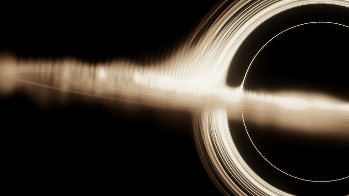

# Gargantua Black Hole · Interstellar-inspired 4K animation

A real-time black hole with off-axis framing, rough accretion gas, warm-white light and a slowly moving camera. Also known as **卡冈图雅黑洞 / 星际穿越风格黑洞**. No visible text, controls or fonts.

[Live preview](https://2bigpig.github.io/gargantua/) · [Offline HTML](https://github.com/2bigpig/gargantua/releases/download/v0.2.0/gargantua.html) · [DSH plugin](https://github.com/2bigpig/dsh-gargantua) · [中文](README.md)



The GIF is compressed. Live and offline rendering use an actual **3840×2160** buffer at every viewport size.

## Watch

Open the live preview, or download `gargantua.html` from [Release v0.2.0](https://github.com/2bigpig/gargantua/releases/tag/v0.2.0) and open it directly. No server, network or development dependencies required. The release includes `SHA256SUMS.txt`.

Use recent WebGPU-capable Chrome, Edge or another compatible browser with hardware acceleration. The renderer also attempts an available WebGL backend. Graphics initialization failure displays a matching still, reported as fallback rather than live animation.

- Fixed actual 3840×2160; rays follow the container aspect ratio to prevent distortion.
- Continuous autoplay, no pause or quality controls. Visibility, intersection and reduced motion do not deliberately pause it.
- A 60fps scheduling ceiling; actual frame rate depends on the GPU. Animation advances by real elapsed time.
- OS sleep, browser freezing, background scheduling and graphics failure can interrupt or limit drawing.

## Build

Node.js 22+:

```sh
git clone https://github.com/2bigpig/gargantua.git
cd gargantua
npm ci
npm run build
```

Outputs `gargantua.html` and `dist/gargantua.js`. Dependencies are locked; runtime assets are embedded. Built outputs are included for immediate use.

## Embed

Serve the module over HTTP(S) and give the container an explicit size:

```html
<div id="black-hole" style="width:100%;height:100vh"></div>
<script type="module">
  import { mountGargantua } from './dist/gargantua.js';
  const animation = await mountGargantua(document.querySelector('#black-hole'), {
    onState(state) { console.log(state.state); }
  });
  console.log(animation.getStats());
  // Call animation.destroy() when the page/component unmounts.
</script>
```

`mountGargantua(container, { onState })` resolves to `resize()`, `getStats()` and idempotent `destroy()`. Statistics include drawing/container dimensions, frames, elapsed scene time and GPU timing when supported. One instance per container. Version 0.2.0 has no playback or quality override API.

## Credits

MIT © 2026 **2bigpig**, based on [dgreenheck/webgpu-black-hole](https://github.com/dgreenheck/webgpu-black-hole) (MIT), using Three.js 0.181.1. Changes include rough volumetric gas, disk integration, off-axis framing, bounded camera motion, lifecycle management, fixed 4K and offline packaging. See [THIRD_PARTY_NOTICES.md](THIRD_PARTY_NOTICES.md) and [LICENSE](LICENSE).

An artistic approximation inspired by *Interstellar*, not the film's DNGR renderer. No film footage or stills. The companion [dsh-gargantua](https://github.com/2bigpig/dsh-gargantua) embeds this scene behind DeepSeek Harness conversations.
